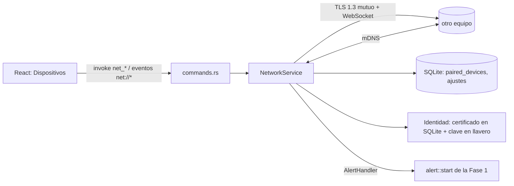

# Arquitectura (Fases 1 y 2)

```
src/                     Frontend (React + TS + Tailwind)
  pages/                 Inicio, Canciones, Configuración (solo UI)
  components/            Sidebar, ChickenDance, Modal, Toasts…
  alert/AlertWindow.tsx  Vista de las ventanas de alerta
  hooks/useAppState.tsx  Estado global (canciones, ajustes, reproducción, alerta)
  lib/                   Lógica pura y probada (filtrar/ordenar, formato)
  services/api.ts        ÚNICA capa que llama a `invoke`
  services/events.ts     Suscripción a eventos del backend
  pages/DevicesPage.tsx  Dispositivos: descubrimiento, emparejamiento, envío
  hooks/useNetworkState.tsx  Estado de red (comandos net_* + eventos net://*)
src-tauri/src/           Backend (Rust)
  db.rs                  SQLite: apertura, migraciones por PRAGMA user_version
  songs.rs               ABM: importar (copia + SHA-256 + validación), editar, borrar
  selection.rs           Selección aleatoria pura (sin I/O)
  settings.rs            Ajustes validados, persistidos en SQLite
  audio.rs               Motor de audio único (hilo dedicado, rodio)
  alert.rs               Ventanas por monitor + ciclo de vida de la alerta
  commands.rs            Comandos Tauri (capa fina)
  lib.rs                 Composición (`Services`) y registro
  net/                   Fase 2 (P2P en LAN), independiente de Tauri:
    service.rs           Servidor+cliente WebSocket/TLS, sesiones, emparejamiento, alertas, reconexión
    protocol.rs          Mensajes v1, validación estricta y límites
    tls.rs               rustls TLS 1.3 mutuo con pinning + código de verificación (SAS)
    identity.rs          Certificado/clave del dispositivo, llavero del SO
    discovery.rs         mDNS (_damebola._tcp.local.)
    store.rs             SQLite: emparejados y ajustes de red
    antispam.rs          Rate limit, token bucket, deduplicación
```

## Decisiones

- **Un solo motor de audio, en Rust.** Las ventanas de alerta no reproducen nada; así el audio suena una vez sin importar cuántos monitores haya, y vista previa y alerta comparten el mismo reproductor (nunca suenan dos pistas a la vez). Un hilo es dueño del stream (no es `Send`) y recibe comandos por un canal; notifica cambios con el evento `playback://status`.
- **Una ventana por monitor, mismo bundle.** Las ventanas `alert-N` cargan `index.html`; `main.tsx` decide por la etiqueta de la ventana qué renderizar. Piden su contexto (`get_alert_context`) al montarse.
- **Ciclo de vida idempotente.** `alert::end` se llama desde el botón, Escape, el temporizador (con número de generación para no cerrar una alerta nueva) o el cierre manual de una ventana (`Destroyed`). Hay una sola alerta activa (`start` falla si ya existe).
- **IDs UUID + hash SHA-256 único** en `songs`: base para sincronizar entre equipos sin colisiones. Fechas en milisegundos UTC. Migraciones versionadas.
- **Importación segura:** copia a `<uuid>.part` calculando el hash, valida firma y decodifica una muestra sobre la copia, comprueba duplicados, renombra y registra; ante cualquier error se limpia el temporal.
- **Seguridad:** sin permisos de filesystem en el frontend; diálogo de archivos y todas las rutas viven en Rust.

## Fase 2: red P2P



- **El frontend no abre sockets.** Solo llama comandos Tauri (`net_*`) y escucha eventos con el estado completo (`net://status`, `net://devices`, `net://pairing`).
- **`NetworkService` no depende de Tauri**: recibe `NetEvents` (salida de eventos) y `AlertHandler` (entrada al sistema de alertas) como traits. Eso permite probarlo con dos instancias reales en un mismo proceso (`net/tests.rs`).
- **Alertas remotas = alertas locales.** `AppAlertHandler` (lib.rs) llama a `alert::start`, el mismo camino que «PROBAR DAME BOLA»: mismas ventanas por monitor, un solo audio, volumen del destinatario, cierre con botón/Esc/temporizador. `alert::start` ya rechaza una alerta si hay otra activa (sin cola).
- **Un hilo de tareas tokio** por conexión; estado compartido tras un `Mutex` que nunca se mantiene durante un `await`.
- **Conexiones:** cualquiera puede iniciar; con duplicados sobrevive la iniciada por el `deviceId` menor. Reconexión con espera exponencial (2 s → 60 s, +jitter), latidos cada 10 s, cierre por inactividad a los 30 s, detección de suspensión/reanudación (salto de reloj > 20 s) y de cambios de IP (cada 5 s).
- **Persistencia:** migración 2 agrega `device_identity` y `paired_devices`; no toca `songs` ni `settings`. Los ajustes de red van como JSON en `settings` (clave `network`).

Detalles: [NETWORK_PROTOCOL.md](NETWORK_PROTOCOL.md), [PAIRING_SECURITY.md](PAIRING_SECURITY.md), [NETWORK_TROUBLESHOOTING.md](NETWORK_TROUBLESHOOTING.md).
