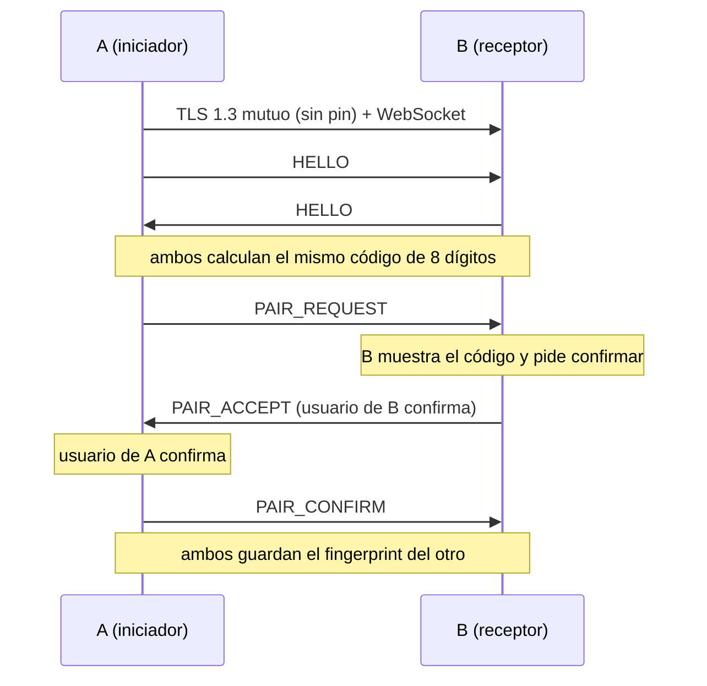
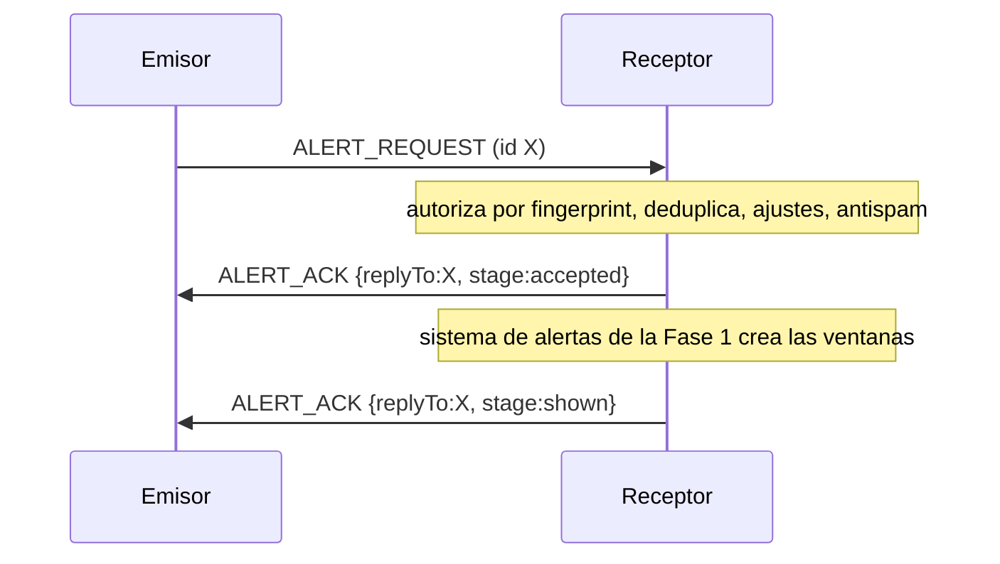

# Protocolo de red de DameBola (v1)

## Transporte

- **TCP** en el puerto configurable (por defecto **38473**).
- **TLS 1.3** (únicamente) con autenticación mutua: ambos extremos presentan un certificado autofirmado. Ver [PAIRING_SECURITY.md](PAIRING_SECURITY.md).
- Sobre TLS, un **WebSocket** (`wss://`) con frames de **texto** JSON. Los frames binarios cierran la conexión.
- Cada instalación es a la vez servidor y cliente. Para un mismo par de dispositivos solo sobrevive **una** conexión: si hay dos, se conserva la iniciada por el dispositivo de `deviceId` menor (ambos lados llegan a la misma conclusión).

## Formato del mensaje

```json
{"v":1,"id":"6f1c0f0e-8a0b-4c8e-9a43-0d3c8f5b1f77","type":"ALERT_REQUEST","body":{}}
```

| Campo | Regla |
|---|---|
| `v` | Entero; debe ser `1`. Otra versión ⇒ se cierra la conexión. |
| `id` | UUID textual (36 caracteres). Identifica el mensaje (deduplicación, respuestas). |
| `type` | Uno de los tipos de abajo. |
| `body` | Objeto con exactamente los campos del tipo (`deny_unknown_fields`). |

Cualquier otra clave de nivel superior, tipo desconocido, campo extra o faltante, JSON inválido o mensaje de más de **4096 bytes** ⇒ la conexión se cierra. Además hay un límite de ~10 mensajes/s por conexión (ráfaga 30).

## Tipos

| Tipo | Cuerpo | Dirección | Descripción |
|---|---|---|---|
| `HELLO` | `deviceId`, `name`, `os`, `appVersion` | ambos, primer mensaje | Presentación. `deviceId` debe ser el derivado del certificado TLS (si no, se cierra). Sin `HELLO` en 10 s ⇒ se cierra. |
| `PAIR_REQUEST` | `{}` | iniciador → receptor | El usuario del iniciador pidió emparejar. |
| `PAIR_ACCEPT` | `{}` | receptor → iniciador | El usuario receptor confirmó que el código coincide. |
| `PAIR_CONFIRM` | `{}` | iniciador → receptor | El usuario iniciador también confirmó; ambos guardan el emparejamiento. |
| `PAIR_REJECT` | `reason`: `declined` \| `mismatch` \| `busy` | cualquiera | Cancela el emparejamiento. |
| `PING` / `PONG` | `{}` / `replyTo` | ambos | Latido cada 10 s; sin tráfico en 30 s ⇒ conexión muerta. |
| `ALERT_REQUEST` | `{}` | emisor → destinatario | Pide mostrar una alerta. **No lleva datos**: ni nombre, ni rutas, ni comandos. |
| `ALERT_ACK` | `replyTo`, `stage`: `accepted` \| `shown` | destinatario → emisor | `accepted`: autenticado y dentro de las reglas. `shown`: las ventanas ya se crearon. |
| `ALERT_REJECT` | `replyTo`, `reason` | destinatario → emisor | `unauthorized`, `rate_limited`, `muted`, `disabled`, `busy`, `failed`. |
| `UNPAIR` | `{}` | cualquiera | Revoca el emparejamiento; el receptor lo borra y cierra. |

`os` ∈ `macos` \| `windows` \| `linux` \| `other`. `name`: 1–40 caracteres, sin controles. `appVersion`: ≤ 32 caracteres `[A-Za-z0-9.+-]`.

## Secuencias

**Emparejamiento** (A inicia):



**Alerta**:



La interfaz del emisor solo dice «mostrada» al recibir `stage: shown`. Estados posibles de un envío: `shown`, `rejected` (con motivo; `accepted` indica si llegó a aceptarse), `offline`, `timeout` (15 s sin respuesta; **no** se asegura entrega) o `error`.

## Reglas del receptor

1. Antes de `HELLO` solo se admite `HELLO`.
2. Un dispositivo **no emparejado** solo puede enviar `HELLO`, `PAIR_*`, `PING/PONG`. Un `ALERT_REQUEST` recibe `ALERT_REJECT unauthorized`; a la tercera, se cierra la conexión.
3. La autorización se evalúa **en cada mensaje** consultando el fingerprint del certificado TLS en la tabla `paired_devices`; revocar surte efecto de inmediato.
4. `ALERT_REQUEST`, en orden: autorización → deduplicación por `id` (un duplicado repite la respuesta original, no vuelve a mostrar nada) → alertas remotas activadas → no silenciado → máximo una alerta cada 15 s por emisor → `ALERT_ACK accepted` → sistema de alertas (si ya hay una alerta en curso: `busy`; no hay cola).
5. El nombre del remitente que se muestra sale del registro del emparejamiento, nunca del mensaje.
6. No se guardan alertas para entregarlas después.
7. Antispam y límites de recursos: 16 handshakes simultáneos, 32 conexiones, 3 emparejamientos activos, 1 `PAIR_REQUEST` cada 10 s por dispositivo.

## Descubrimiento (mDNS)

Servicio `_damebola._tcp.local.`, instancia = `deviceId`. Registros TXT: `id`, `name`, `os`, `v` (versión de protocolo). Puerto = el de escucha. **Nada sensible.** Los datos de mDNS no están autenticados: solo sirven para saber a dónde conectar; la identidad real se comprueba en TLS y en el emparejamiento.

Solo se anuncia por las interfaces LAN en las que se escucha (IPv4 privadas o link-local). Las entradas descubiertas desaparecen por baja mDNS o a los 10 minutos sin verse y sin conexión.

## Compatibilidad futura

Un cambio incompatible incrementa `v`. Un par con otra versión no llega a procesarse (el mensaje se rechaza y se cierra la conexión).

## Fase 2.5: aclaraciones (el protocolo **no cambió**: sigue en la versión 1)

- **Significado de `ALERT_ACK stage=shown`:** el destinatario creó, posicionó y pidió mostrar **todas** las ventanas de alerta (una por monitor) sin error del sistema operativo. Si cualquier ventana falla, se cancelan todas las ya abiertas, **no suena audio** y se responde `ALERT_REJECT reason=failed` (error de visualización; el emisor ya recibió `accepted`). No garantiza que una persona haya visto la pantalla.
- **Desconexión voluntaria:** cuando el usuario pulsa *Desconectar*, el cierre WebSocket usa el código `4001` (rango privado 4000–4999, razón `user-disconnect`). Un par que lo entiende no vuelve a conectarse solo; un par más viejo lo ve como un cierre normal. Un equipo desconectado a propósito también cierra con `4001` las conexiones entrantes de ese par. No se agregó ningún tipo de mensaje ni razón nuevos.
- **Nombres:** el nombre del `HELLO` (autenticado por TLS) actualiza el *nombre anunciado* guardado; el alias local nunca viaja ni se sobrescribe. Los TXT de mDNS no escriben nada guardado.
